# ADRIA × ENSET — Plateforme bancaire distribuée

**Épreuve technique de sélection — Architecture micro-services, IA et développement full-stack**  
**Durée indiquée dans l'énoncé : 3 heures** · **Statut : projet POC fourni, déploiement à vérifier sur machine équipée**

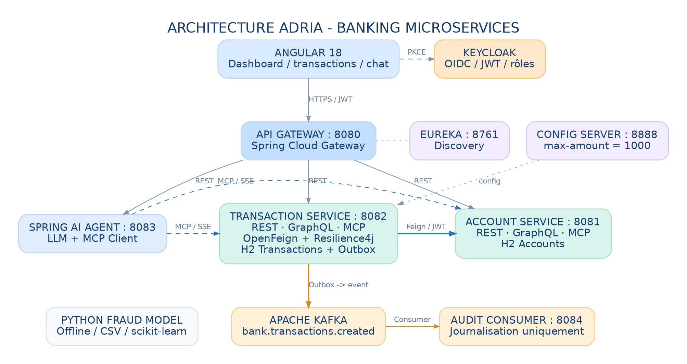

> **Statut et traçabilité :** Le CSV fourni a été traité : **5 000 transactions dont 257 fraudes (5,14 %)**. Le pipeline Python a été exécuté sur ce fichier, les métriques et figures ont été calculées, et les tests Python ont réussi (**6/6**). Les applications Maven, Docker, Keycloak et Angular restent à compiler/démarrer et à photographier sur le poste de l'étudiant : aucun succès n'est inventé. L'analyse des fraudes est expérimentale et n'est **pas** déployée dans les microservices, conformément à l'énoncé.

### Profil de candidature : priorités de spécialisation

**1. Data Science (partie H — priorité principale)** · **2. Full Stack (parties C à G)** · 3. Mobile · 4. Business Analyst. La partie **G** est satisfaite par **Angular uniquement** : **aucune application mobile Flutter** n'est développée. Le rapport détaille davantage la méthode et les résultats de la partie H pour démontrer la maîtrise des données, de l'IA et de l'évaluation reproductible.

#### Résumé Data Science — résultats sur le CSV fourni

| Indicateur | Résultat effectif |
|---|---:|
| Transactions / fraudes | **5 000 / 257 (5,14 %)** |
| Entraînement / test stratifié | **3 750 / 1 250** |
| Modèle sélectionné sur validation croisée du train | **Régression logistique pondérée** |
| Average Precision sur test | **0,1885** |
| Précision / rappel fraude au seuil 0,50 | **10,36 % / 54,69 %** |
| F1 fraude au seuil 0,50 | **0,1741** |
| Matrice de confusion au seuil 0,50 (VN/FP/FN/VP) | **883 / 303 / 29 / 35** |
| Tests Python effectivement exécutés | **6 réussis** |

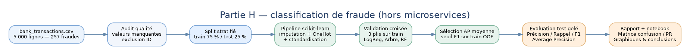

**Présentation Data Science** : voir [la partie H détaillée](#10-intelligence-artificielle--fraude), [le notebook Jupyter exécuté](fraud/Analyse_Fraude_ADRIA.ipynb) et [les résultats calculés](fraud/results/metrics.json). Les valeurs de performance restent limitées : le modèle ne doit pas être qualifié de « performant en production » sur ce seul test.

## Sommaire

1. [Contexte métier et objectifs](#1-contexte-métier-et-objectifs)
2. [Conformité à l'énoncé — Parties A à I](#2-conformité-à-lénoncé--parties-a-à-i)
3. [Conception UML et architecture](#3-conception-uml-et-architecture)
4. [Versions et dépendances Maven](#4-versions-et-dépendances-maven)
5. [Arborescence et séparation des responsabilités](#5-arborescence-et-séparation-des-responsabilités)
6. [Règles métier et gestion des erreurs](#6-règles-métier-et-gestion-des-erreurs)
7. [API REST, GraphQL et MCP](#7-api-rest-graphql-et-mcp)
8. [Configuration, découverte et tolérance aux pannes](#8-configuration-découverte-et-tolérance-aux-pannes)
9. [Spring AI, Keycloak, Kafka et Docker](#9-spring-ai-keycloak-kafka-et-docker)
10. [Intelligence artificielle — Fraude](#10-intelligence-artificielle--fraude)
11. [DevOps / CI-CD](#11-devops--ci-cd)
12. [Démarrage et tests](#12-démarrage-et-tests)
13. [Captures d'écran à réaliser](#13-captures-décran-à-réaliser)
14. [Analyse critique et limites du POC](#14-analyse-critique-et-limites-du-poc)
15. [Références](#15-références)

---

## 1. Contexte métier et objectifs

Une banque souhaite gérer des **comptes**, enregistrer des **transactions**, effectuer des **virements internes**, diffuser les événements métier via Kafka et permettre des consultations en langage naturel par l'intermédiaire d'un assistant **Spring AI + MCP**. La solution comprend aussi une interface Angular, la sécurité Keycloak, une architecture Docker et une expérience de détection de fraude par machine learning en Python.

L'architecture reprend la progression des travaux de **Mohamed Youssfi (ENSET)** : **Entity → Repository → Service → REST/GraphQL/MCP**, puis Eureka, Gateway, Config Server, OpenFeign, Resilience4j, Kafka, frontend, tests et DevOps.

**Choix techniques :** deux services métier (account-service, transaction-service) et cinq composants Java techniques (discovery-service, config-service, gateway-service, ai-agent-service, event-consumer-service). Les autres composants sont Angular, Keycloak, Kafka/ZooKeeper et Python offline.

## 2. Conformité à l'énoncé — Parties A à I

| Partie | Exigence | Livré / comment vérifier |
|:--|:--|:--|
| **A** | Repo GitHub **privé** `nom-prenom-test-adria-pfe-27`, Google Sheet, commits toutes les 15 min, rapport PDF, repo public à la fin, Classroom | **Action personnelle requise**. Le code et `rapport/Compte_rendu_ADRIA.pdf` sont livrés ; aucune action sur GitHub, Sheet ou Classroom n'a été simulée. |
| **B** | Diagramme de classes et architecture | `docs/diagramme-classes.png`, `docs/architecture.png`, sources `.dot` / `.svg` et séquences de transactions |
| **C** | Account, Transaction, REST, GraphQL, MCP, Feign, Resilience4j | Modules métier, couches explicites, appels Feign et circuit breaker ; contrôleurs et outils MCP s'appuient sur la même couche Service |
| **D** | Gateway, Eureka, Config Server, plafond `bank.transaction.max-amount=1000` | Modules Spring Cloud ; fichier `config-service/src/main/resources/config-repo/transaction-service.yml` |
| **E** | Agent Spring AI avec outils MCP, test REST / Telegram / Discord | `ai-agent-service` avec client MCP SSE et REST `POST /api/chat` ; Telegram et Discord non ajoutés car l'énoncé offre des choix de clients pour le test |
| **F** | Publier `TransactionCreated` dans `bank.transactions.created`, clé `accountId`, consumer en lecture seule | Entité Outbox, publication Kafka avec clé `accountId`, consumer qui journalise uniquement |
| **G** | Client React/Angular ou Flutter | **Angular 18 uniquement** (choix client web autorisé) : comptes, opérations, virements, assistant. Pas de Flutter. |
| **H — priorité 1** | Classification Python des fraudes, métriques, analyse | **CSV fourni traité** : notebook exécuté, 3 modèles comparés en CV, résultats test, courbes, JSON/CSV, 6 tests Python réussis. |
| **I** | Dockerfiles, Compose, pipeline CI/CD, secrets/health/logs/rollback | `Dockerfile` multi-module, `compose.yml`, `.github/workflows/ci.yml`, discussion section 11 |

## 3. Conception UML et architecture

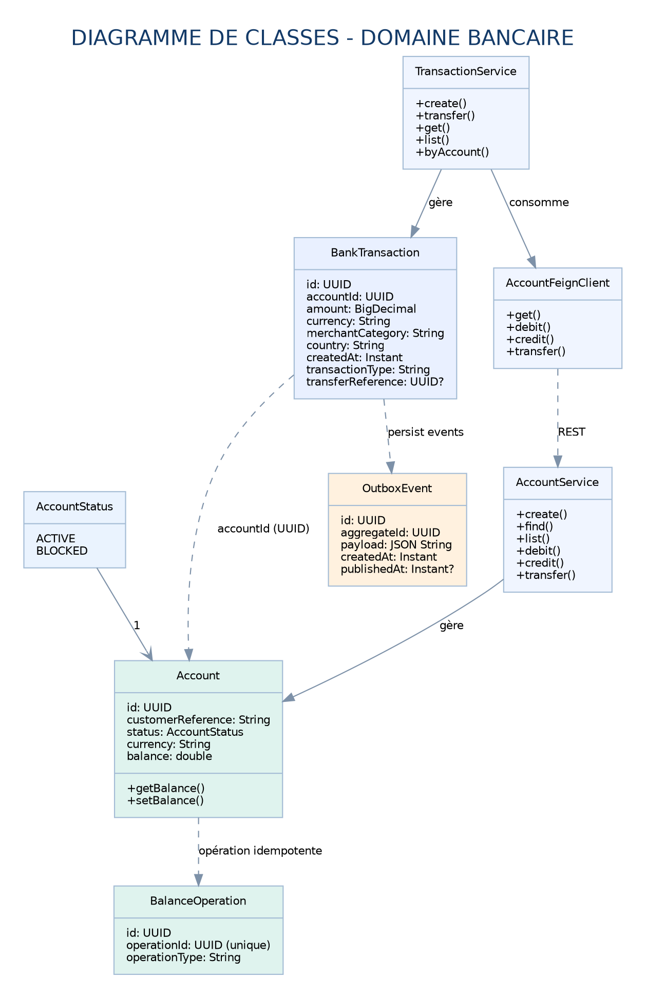

**Lecture des classes :** `Account` possède un `UUID`, la référence client, le statut `ACTIVE/BLOCKED`, la devise et le solde (`double`, conformément au modèle minimal). `BankTransaction` possède `UUID`, `accountId`, `amount: BigDecimal`, la devise, la catégorie commerçant, le pays et `createdAt: Instant`. `BalanceOperation` empêche le retrait répété pour un identifiant d'opération ; `OutboxEvent` assure la transmission différée du message après enregistrement local.

> Le lien `BankTransaction.accountId → Account.id` est une **référence externe**, non une relation JPA entre bases : les services possèdent des données séparées. Le rapprochement est réalisé via REST/OpenFeign.

**Scénario d'une transaction**

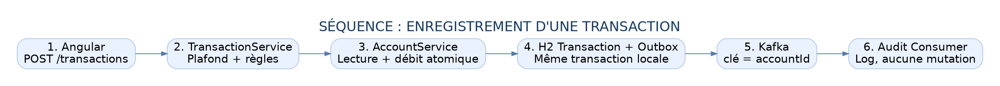

1. Le client transmet `accountId`, `amount`, `currency`, `merchantCategory`, `country`.
2. `TransactionService` vérifie montant strictement positif, plafond partagé et devise / statut du compte via OpenFeign.
3. `AccountService` verrouille le compte (`PESSIMISTIC_WRITE`) et débite le montant, une seule fois par `operationId`.
4. `TransactionService` enregistre la transaction et son Outbox dans une **transaction locale unique**.
5. Un publisher planifié envoie l'événement Kafka **après** persistance, avec `accountId` comme clé.
6. `AuditConsumer` journalise le message, sans mutation des données.

**Scénario d'un virement**

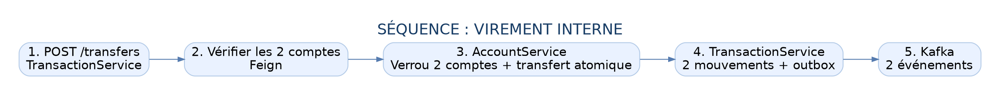

Le service Transaction vérifie les comptes, puis demande au service Account de débiter le compte source et créditer le destinataire dans **une transaction locale atomique sur la base de comptes**. Deux mouvements métier sont ensuite enregistrés (`TRANSFER_OUT` et `TRANSFER_IN`) dans TransactionService. Si l'enregistrement échoue après déplacement des fonds, une compensation de meilleure-effort est tentée ; une vraie stratégie **Saga orchestrée + journal d'opérations + réconciliation** serait nécessaire en production.

## 4. Versions et dépendances Maven

| Élément | Version ou starter | Motif |
|:--|:--|:--|
| Java | **21** | Version du dépôt de référence `micro-services-app` du professeur |
| Spring Boot | **3.4.2** | Compatible avec Spring AI 1.0.x ; présent dans l'exemple Kafka du professeur |
| Spring Cloud | **2024.0.0** | Aligné sur Spring Boot 3.4.x |
| Spring AI | **1.0.3** | Client/serveur MCP, outil d'agent et modèle OpenAI |
| Springdoc OpenAPI | **2.8.4** | Swagger UI pour les microservices Spring MVC |
| Angular | **18.2.x** | Frontend standalone, HttpClient, formulaire et Keycloak PKCE |
| Keycloak | **26.0** | Identité et autorisations par JWT |
| Kafka Confluent | **7.6.1** | Broker et ZooKeeper Docker pour l'activité Event Driven |

**Principales dépendances par rôle :**

- Account : `spring-boot-starter-web`, `spring-boot-starter-data-jpa`, `spring-boot-starter-graphql`, `spring-boot-starter-validation`, `h2`, `spring-ai-starter-mcp-server-webmvc`, `springdoc-openapi-starter-webmvc-ui`, Eureka, Security/OAuth2 Resource Server.
- Transaction : mêmes dépendances de base, plus `spring-cloud-starter-openfeign`, `spring-cloud-starter-circuitbreaker-resilience4j`, `spring-kafka`.
- Config : `spring-cloud-config-server` ; Discovery : `spring-cloud-starter-netflix-eureka-server` ; Gateway : `spring-cloud-starter-gateway` ; Agent : `spring-ai-starter-model-openai` et `spring-ai-starter-mcp-client`.

`pom.xml` racine importe les BOM Spring Cloud et Spring AI pour éviter des versions dispersées. La présence des dépendances ne constitue pas une compilation validée (voir section 12).

## 5. Arborescence et séparation des responsabilités

```text
ADRIA_Bank_Platform/
├── pom.xml                      # Maven parent (7 modules)
├── discovery-service/          # Eureka :8761
├── config-service/             # Spring Config :8888 + config-repo
├── gateway-service/            # Routes API :8080
├── account-service/            # REST + GraphQL + MCP :8081
│   └── src/main/java/.../
│       ├── domain/
│       ├── repository/
│       ├── service/
│       ├── web/rest/
│       ├── web/graphql/
│       └── mcp/
├── transaction-service/        # REST + GraphQL + MCP + Feign :8082
│   └── src/main/java/.../
│       ├── domain/ repository/ service/
│       ├── client/ web/rest/ web/graphql/ mcp/
├── ai-agent-service/           # Spring AI :8083
├── event-consumer-service/     # Consumer Kafka :8084
├── frontend/                   # Angular :4200
├── fraud/                      # PARTIE H prioritaire : CSV, notebook Jupyter, pipelines, tests et figures
├── docs/                       # 4 schémas PNG + SVG + DOT
├── infra/keycloak/             # Realm de démonstration
├── .github/workflows/ci.yml    # Pipeline
├── Dockerfile                  # Image paramétrée MODULE
├── compose.yml                 # Environnement local
└── rapport/Compte_rendu_ADRIA.pdf
```

**Même couche métier pour trois connecteurs** : par exemple `AccountRestController`, `AccountGraphqlController` et `AccountTools` dépendent de `AccountService`. Aucune logique bancaire de calcul ne doit être reproduite dans les contrôleurs.

## 6. Règles métier et gestion des erreurs

| Cas | Traitement métier | Code HTTP attendu |
|:--|:--|:--|
| Montant nul ou négatif | Rejet immédiat | `400` |
| Montant > plafond **1000** | Rejet de la transaction/virement | `400` |
| `accountId` inexistant | Pas de débit | `404` via Feign (si disponible) |
| Compte `BLOCKED` | Rejet du débit/virement | `409` |
| Devise différente de celle du compte | Rejet | `400` |
| Solde insuffisant | Rejet du débit | `409` |
| Virement source = destinataire | Rejet | `400` |
| Account-service en panne | Circuit breaker, pas de solde fictif | `503` |
| Kafka momentanément indisponible | Outbox reste à publier et sera réessayé | Non bloquant pour transaction persistée |
| Opération déjà enregistrée avec le même `operationId` | Pas de nouveau mouvement bancaire | Idempotence métier |

**Précision :** le solde en `double` respecte l'énoncé, mais une application bancaire réelle doit utiliser `BigDecimal` en persistance. Les calculs dans `AccountServiceImpl` passent temporairement par `BigDecimal` ; cela n'annule pas les limites du stockage double.

**Attention aux défaillances distribuées :** un appel réseau interrompu après le débit peut laisser son issue ambiguë. Ce POC met en place un identifiant d'opération pour l'idempotence et une compensation best-effort ; il n'est pas un moteur bancaire transactionnel de production.

## 7. API REST, GraphQL et MCP

### REST via Gateway `localhost:8080`

| Méthode | URL | Fonction |
|:--|:--|:--|
| GET | `/api/accounts` | Liste comptes |
| GET | `/api/accounts/{uuid}` | Compte et solde |
| POST | `/api/accounts` | Créer un compte |
| PATCH | `/api/accounts/{uuid}/status` | Bloquer/activer |
| GET | `/api/transactions` | Liste des transactions |
| GET | `/api/transactions/{uuid}` | Transaction par id |
| GET | `/api/transactions?accountId={uuid}` | Transactions d'un compte |
| POST | `/api/transactions` | Transaction/debit |
| POST | `/api/transfers` | Virement interne |
| POST | `/api/chat` | Requête chatbot agentique |

Exemple de compte :

```json
{"customerReference":"CUST-003","currency":"EUR","balance":1500.0}
```

Exemple de transaction :

```json
{"accountId":"REMPLACER_PAR_UUID","amount":250.00,"currency":"EUR","merchantCategory":"SHOPPING","country":"MA"}
```

Exemple de virement :

```json
{"sourceId":"UUID_SOURCE","destinationId":"UUID_DEST","amount":100.00,"currency":"EUR"}
```

> Remplacer les identifiants par ceux retournés par `GET /api/accounts`. Pour les **API internes** de mise à jour du solde, le contrat est `/internal/accounts/{id}/debit|credit`, et `/internal/accounts/transfer` : **ne pas exposer ces routes via Gateway**.

### Swagger UI / OpenAPI

Les documentations REST sont disponibles directement auprès de chaque service métier après démarrage :

- http://localhost:8081/swagger-ui/index.html ; http://localhost:8081/v3/api-docs
- http://localhost:8082/swagger-ui/index.html ; http://localhost:8082/v3/api-docs
- http://localhost:8083/swagger-ui/index.html ; http://localhost:8083/v3/api-docs

### GraphQL

- Account : `POST http://localhost:8081/graphql`, ou **Gateway** `POST http://localhost:8080/graphql/accounts`.
- Transaction : `POST http://localhost:8082/graphql`, ou **Gateway** `POST http://localhost:8080/graphql/transactions`.

Exemple :

```graphql
query { accounts { id customerReference currency balance status } }
```

```graphql
query { transactions { id accountId amount currency createdAt transactionType } }
```

Mutation comptes :

```graphql
mutation { openAccount(customerReference:"CUST-010",currency:"EUR",balance:250) { id balance } }
```

Mutation transactions :

```graphql
mutation { registerTransaction(accountId:"UUID_REEL",amount:"25.00",currency:"EUR",merchantCategory:"FOOD",country:"MA") { id amount } }
```

### MCP (Spring AI)

Les services Account et Transaction publient des **Tools** basés sur les mêmes interfaces métier. Les outils de compte permettent la consultation ; les outils de transaction permettent la consultation et, avec autorisation explicite, l'enregistrement et le virement. Les endpoints MCP utilisent **SSE** (`/sse`) via le starter Spring AI 1.0.x ; l'agent y accède par réseau interne. Une URL MCP ouverte sans protection réseau n'est **pas acceptable en production**.

## 8. Configuration, découverte et tolérance aux pannes

Eureka expose l'annuaire sur http://localhost:8761. Chaque service s'enregistre avec `spring.application.name`; Gateway emploie `lb://account-service`, `lb://transaction-service` et `lb://ai-agent-service`. La communication Transaction → Account utilise **OpenFeign** et une instance **Resilience4j Circuit Breaker** nommée `account-service`.

`config-service` fonctionne en mode Spring Cloud Config **native** (sans dépôt externe à initialiser) :

```yaml
# config-service/src/main/resources/config-repo/transaction-service.yml
bank:
  transaction:
    max-amount: 1000
```

Test du serveur de configuration : http://localhost:8888/transaction-service/default. Le service Transaction utilise `spring.config.import=optional:configserver:...`, avec valeur locale de secours `1000` pour le démarrage de démonstration.

## 9. Spring AI, Keycloak, Kafka et Docker

### Spring AI

Le module `ai-agent-service` expose `POST /api/chat` et fournit au LLM les Tools distants MCP. Sa configuration exige une clé **personnelle** `OPENAI_API_KEY` dans `.env` ; aucune clé n'est fournie ou intégrée dans le dépôt.

```json
{"message":"Montre les comptes actifs et leurs soldes","confirmWrites":false}
```

`confirmWrites=false` retire les outils d'écriture de la requête ; pour une opération par chatbot, l'utilisateur doit explicitement activer `confirmWrites=true`. Il s'agit d'une confirmation **par requête**, pas encore d'un processus d'approbation bancaire fort.

**Clients** : le REST ci-dessus et l'interface Angular suffisent aux tests demandés. Telegram et Discord sont des canaux facultatifs, non implémentés dans cette version.

### Keycloak

Le realm `bank` est importé via `infra/keycloak/bank-realm.json`. Le client Angular `bank-ui` utilise **Authorization Code + PKCE**. Deux comptes **strictement de démonstration** :

| Utilisateur | Mot de passe local | Rôles |
|--|--|--|
| `viewer` | `viewer-demo-123` | `VIEWER` |
| `operator` | `operator-demo-123` | `VIEWER`, `OPERATOR` |

Keycloak : http://localhost:8085 (administrateur **demo local** `admin` / `admin-local-only`). Les ports sont liés à `127.0.0.1` dans Compose, pas exposés sur internet. **Remplacer tous ces identifiants, et protéger les interfaces internes, avant toute exposition réelle.**

`BANK_SECURITY_ENABLED=true` (par défaut dans Compose) active la vérification des JWT sur Gateway et les services métier. Le relais des tokens REST est configuré pour OpenFeign ; les outils MCP appelés depuis l'agent peuvent utiliser le client de service `bank-svc` via les variables `BANK_SERVICE_CLIENT_SECRET` / `SERVICE_TOKEN_URL`. **La configuration des rôles et des flux service-to-service doit être testée sur le Keycloak importé** ; ce POC ne constitue pas une validation de sécurité externe.

### Kafka

Topic : **`bank.transactions.created`**. Format de l'événement :

```json
{
  "eventId": "UUID",
  "eventType": "TransactionCreated",
  "transactionId": "UUID",
  "accountId": "UUID",
  "amount": 250.00,
  "currency": "EUR",
  "occurredAt": "2026-01-15T10:30:00Z"
}
```

L'événement est stocké dans `OutboxEvent` avec la transaction, puis envoyé au broker Kafka sous la clé **`accountId`**. Le consumer d'audit **ne change aucun solde**. La livraison peut être **au moins une fois** : une déduplication des `eventId` côté consumer serait à ajouter pour une vraie garantie de traitement unique.

## 10. Intelligence artificielle — Fraude

**PARTIE H — PREMIER CHOIX DE STAGE : DATA SCIENCE.** L'analyse suivante est directement tirée du fichier `bank_transactions.csv` remis avec l'épreuve (5 000 lignes, 9 colonnes). Le code ne simule ni les résultats ni le dataset. L'évaluation repose sur **1 250 transactions réellement présentes dans le fichier fourni**, mises de côté avant la sélection du modèle.

### 10.1 Objectif et jeu de données

Prédire `is_fraud` (0 : non fraude, 1 : fraude). Les **257 fraudes sur 5 000 transactions** représentent **5,14 %** des observations. Les 4 743 autres cas (94,86 %) expliquent le déséquilibre. Les variables sont `amount`, `hour`, `country`, `merchant_category`, `transactions_last_24h` et `average_amount_last_7d`. **`transaction_id` et `account_id` sont exclus des variables explicatives** : ce sont des identifiants.

| Champ | Valeurs manquantes | Décision |
|---|---:|---|
| `country` | 66 | Imputation par valeur la plus fréquente sur train |
| `merchant_category` | 84 | Même imputation + OneHotEncoder |
| `average_amount_last_7d` | 75 | Imputation par médiane sur train |
| autres colonnes | 0 | Conservation, aucun identifiant en entrée du modèle |

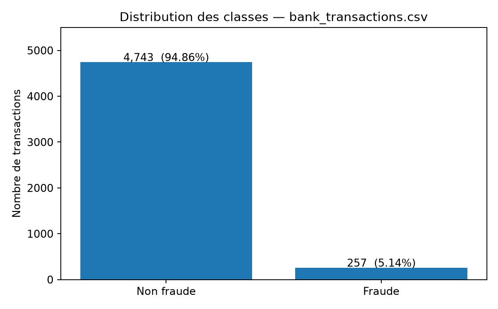
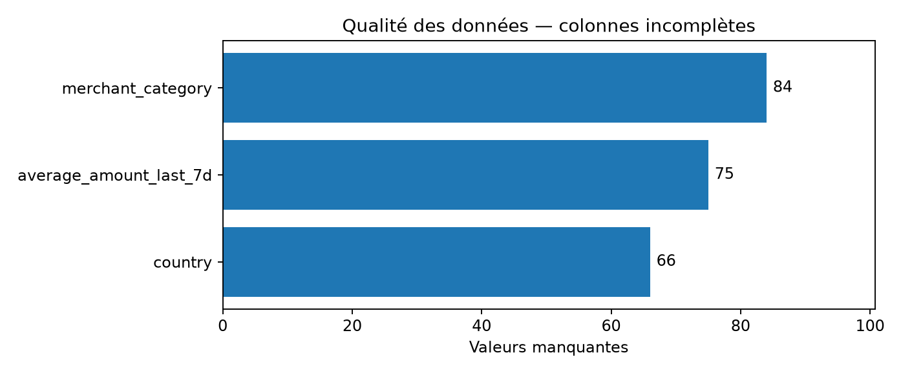

### 10.2 Pipeline anti-fuite et sélection de modèle

Le fichier `fraud/train.py` contient l'entraînement reproductible (seed 42). Le découpage **75 % apprentissage / 25 % test stratifié** préserve la proportion de fraudes. **Seules les 3 750 lignes d'apprentissage** participent à l'ajustement de l'imputation, de la standardisation et du One-Hot Encoding (pipeline `scikit-learn`). Le jeu test reste isolé pendant la comparaison.

Trois algorithmes ont été comparés en **validation croisée stratifiée à trois plis sur le seul entraînement**, avec l'**Average Precision (AP)** comme critère de sélection adapté à la classe rare :

| Modèle | AP moyenne en CV (train) | Écart-type |
|---|---:|---:|
| **Régression logistique pondérée** | **0,1833** | 0,0209 |
| Random Forest pondérée | 0,1131 | 0,0127 |
| Arbre de décision pondéré | 0,0935 | 0,0150 |

Le modèle retenu est la **régression logistique pondérée** ; elle est ensuite réentraînée sur les 3 750 observations d'entraînement. Le **seuil fixe 0,50** est le point de référence ; un **seuil exploratoire 0,80**, choisi uniquement sur les probabilités hors pli (*out-of-fold*) du train en maximisant le F1, illustre le compromis métier. **Le test n'a servi ni à choisir le modèle, ni à ajuster le seuil.**

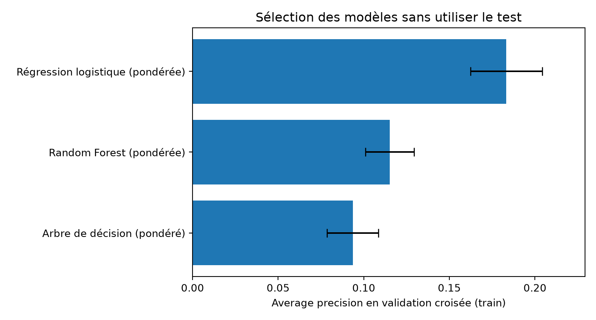

### 10.3 Résultats finaux sur le test indépendant (n = 1 250, fraudes = 64)

| Stratégie de décision | Accuracy | Précision fraude | Rappel fraude | F1 fraude | FP | FN | VP |
|---|---:|---:|---:|---:|---:|---:|---:|
| Toujours « non fraude » | **94,88 %** | 0 % | **0 %** | 0 | 0 | 64 | 0 |
| **Modèle, seuil 0,50** | 73,44 % | 10,36 % | **54,69 %** | 0,1741 | 303 | 29 | **35** |
| Modèle, seuil 0,80 (fixé sur train) | 92,48 % | **23,21 %** | 20,31 % | **0,2167** | 43 | 51 | 13 |

**Average Precision test : 0,1885. ROC-AUC test :** voir `fraud/results/metrics.json`. Au seuil **0,50**, matrice de confusion : **VN=883, FP=303, FN=29, VP=35**. Le modèle identifie 35 des 64 fraudes du test, au prix de 303 fausses alertes ; c'est une limite opérationnelle significative. Au seuil **0,80**, il déclenche moins de fausses alertes, mais passe à côté de 51 fraudes. Nous ne présentons **aucun** de ces seuils comme optimal pour une banque sans matrice des coûts métier.

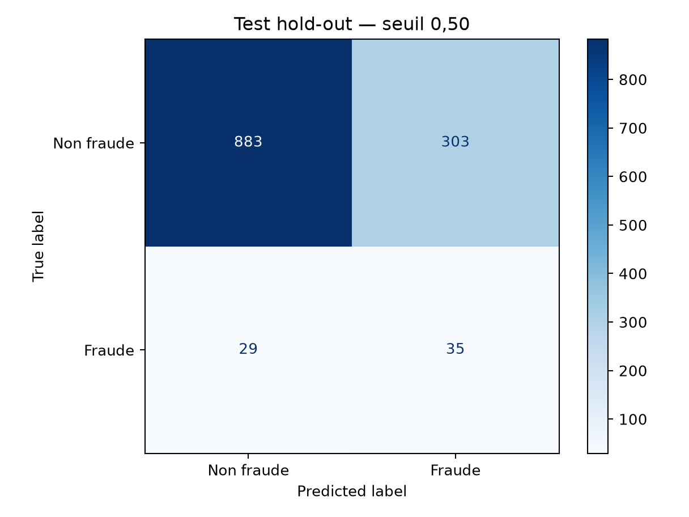
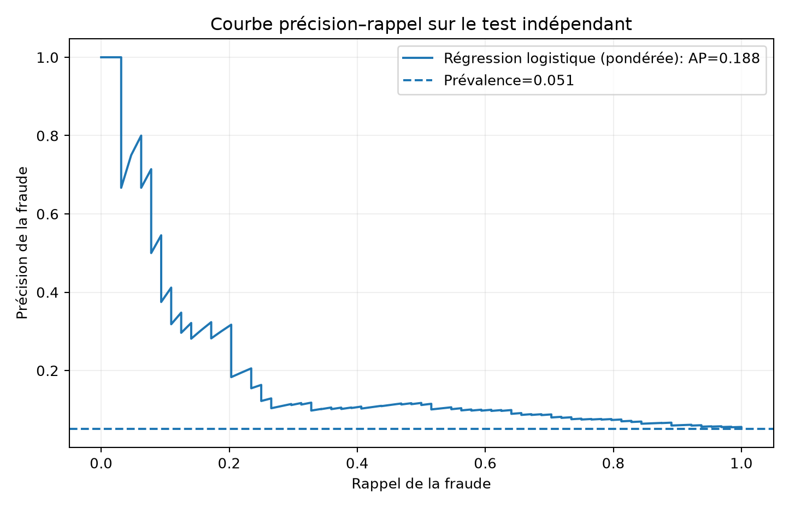
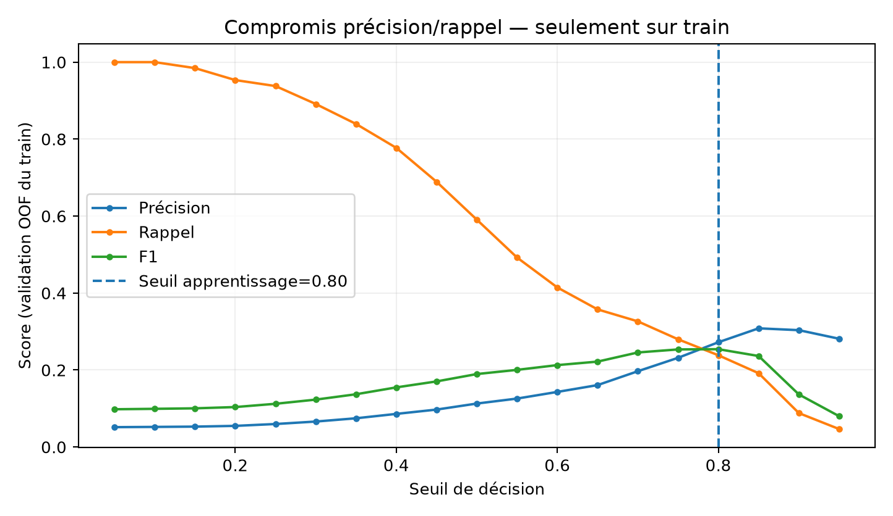

### 10.4 Interprétabilité, limites et esprit critique

L'importance des variables par permutation est calculée **sur l'entraînement**, et non utilisée pour sélectionner le modèle sur le test. Elle renseigne sur la dépendance prédictive, sans fournir d'explication causale sur chaque transaction.

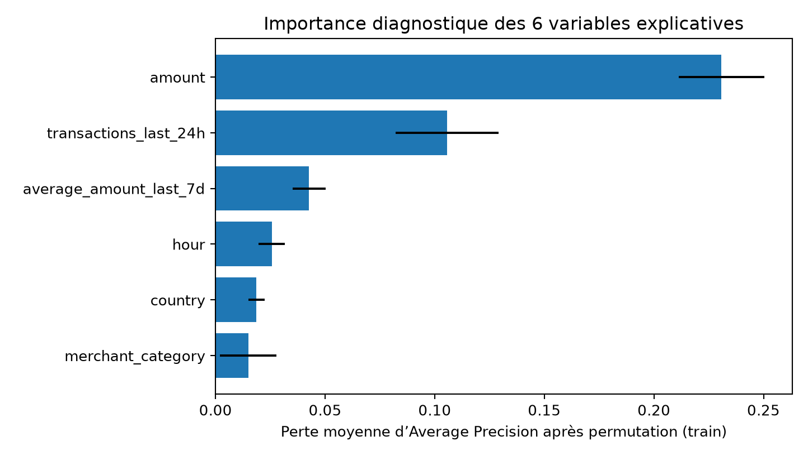

**Limites à expliquer au jury :** le fichier contient un champ `hour` mais **pas d'horodatage complet** ; la validation temporelle n'est donc **pas réalisable** avec les données fournies. Les mêmes comptes peuvent apparaître à la fois en apprentissage et en test, même si `account_id` n'entre pas dans le modèle. Le coût des faux positifs et des fraudes manquées n'est pas chiffré. La qualité des résultats est modeste, aucune calibration ni surveillance du drift n'est testée en production. **L'énoncé exclut expressément le déploiement du modèle** dans l'application bancaire.

### 10.5 Exécution, notebook et preuve de résultats

```bash
cd fraud
python -m pip install -r requirements.txt
python train.py --csv data/bank_transactions.csv --out results
python -m pytest -q test_train.py
# Ouvrir le notebook exécuté dans VS Code ou Jupyter :
jupyter notebook Analyse_Fraude_ADRIA.ipynb
```

- **Notebook** : [`fraud/Analyse_Fraude_ADRIA.ipynb`](fraud/Analyse_Fraude_ADRIA.ipynb), avec exploration, comparaisons, matrices et commentaire métier, exécuté sur le CSV fourni.
- **Code source** : [`fraud/train.py`](fraud/train.py) ; **6 tests unitaires** effectués avec succès (données artificielles utilisées **seulement** pour vérifier les tests).
- **Résultats** : `fraud/results/metrics.json`, `dataset_profile.json`, `comparaison_modeles_cv.csv`, `analyse_seuil_sur_train.csv`, `importance_variables.csv`, `predictions_test.csv`, graphiques PNG et `fraud_pipeline.joblib`. Le modèle `joblib` est local ; **ne jamais charger un joblib non fiable**.
- **Données / confidentialité** : le CSV fourni est joint au **ZIP pédagogique**, mais `fraud/data/*.csv` est ignoré dans Git. Vérifier l'autorisation de publication avant tout dépôt public. Le fichier `predictions_test.csv` et le modèle sérialisé sont également ignorés dans Git.

### 10.6 Réponses aux quatre questions d'analyse

1. **Pourquoi l'accuracy seule est-elle insuffisante ?** Sur le test, prédire toujours « non fraude » donne **94,88 % d'accuracy** mais **0/64 fraudes détectées**. Le rappel, la précision, le F1 et l'Average Precision sont essentiels.
2. **Compromis entre faux positifs et fraudes non détectées ?** Au seuil 0,50, nous avons **303 fausses alertes pour 29 fraudes manquées** ; à 0,80, seulement **43 fausses alertes**, mais **51 fraudes manquées**. Le seuil relève du coût bancaire, pas seulement d'un score statistique.
3. **Effet d'une diminution du seuil ?** Passer de **0,80 à 0,50** fait croître le rappel de **20,31 % à 54,69 %**, tout en multipliant les faux positifs de **43 à 303** sur ce jeu de test. Les deux seuils ont été fixés sans s'appuyer sur le test.
4. **Pourquoi une validation temporelle ?** En production, on apprend sur les transactions passées et on évalue sur les transactions futures pour tester dérive et éviter l'utilisation d'informations ultérieures. L'absence de timestamp complet dans le fichier rend cette validation impossible ici ; il serait méthodologiquement incorrect d'utiliser `hour` comme une chronologie.

**Périmètre confirmé :** le modèle Python reste expérimental, **sans API REST Flask/FastAPI, sans consommation Kafka et sans intégration aux microservices**, puisque son déploiement n'est pas demandé dans la partie H.

## 11. DevOps / CI-CD

- **Image unique réutilisable** : `Dockerfile`, paramètre de build `MODULE` pour chacun des 7 modules Java.
- **Docker Compose** : ZooKeeper, Kafka, Keycloak, 7 modules Java, Angular.
- **CI** : `.github/workflows/ci.yml` lance `mvn verify`, **les tests Python Data Science dans un job séparé**, construit Angular, puis fabrique et publie les images Java sur **GHCR** pour les commits sur `main`.
- **Déploiement** : étape `deploy-example` volontairement désactivée (`if: false`) : **schématique**, car l'énoncé n'exige aucun cloud réel.

**Réponses courtes I.4 :**

| Sujet | Proposition |
|--|--|
| Secrets vs configuration | Configuration non sensible dans Spring Config et variables d'environnement ; secrets dans GitHub Secrets / variables injectées / secret manager, jamais dans Git ni README. Exemple Keycloak contient **uniquement** des credentials de démonstration. |
| Démarrage, disponibilité, vitalité | Actuator `/actuator/health` ; readiness/liveness probes à ajouter sur le déploiement cible ; `depends_on` contrôle **l'ordre de démarrage** mais n'attend pas à lui seul qu'un service soit prêt. |
| Logs, métriques, traces | SLF4J/Logback, Actuator et métriques ; ajouter Micrometer/Prometheus/Grafana et OpenTelemetry/Zipkin pour observabilité centralisée complète. Non intégrés de bout en bout dans ce POC. |
| Rollback | Publication d'images immuables taguées au SHA ; retour à l'image précédente après contrôle santé ; migrations de schéma compatibles ; maintien d'une version N-1 stable. |

## 12. Démarrage et tests

### Pré-requis

**Java 21, Maven 3.9+, Docker Engine + Docker Compose, Node 20/22 et npm, Python 3.10+**. Idéalement 8 Go de RAM pour les conteneurs. Cloner le dépôt sur Windows avec Git ou ouvrir le dossier dans IntelliJ / VS Code.

### Démarrage Docker complet

```bash
cp .env.example .env
# renseigner OPENAI_API_KEY si le chatbot doit être utilisé
# sur Windows PowerShell: Copy-Item .env.example .env
docker compose -f compose.yml build
docker compose -f compose.yml up -d
# Logs, vérification et arrêt
docker compose ps
docker compose logs -f transaction-service
docker compose down
```

**Attention :** ne pas démarrer la pile bancaire sur un réseau public avec ces identifiants de test. Le lancement simultané peut nécessiter un redémarrage du service Agent après que MCP et Keycloak sont disponibles : `docker compose restart ai-agent-service`. Pour tester **sans Keycloak** en local, placer `BANK_SECURITY_ENABLED=false` dans `.env` et redémarrer les services ; cela ne constitue plus un test de sécurité.

### Tests rapides, si `BANK_SECURITY_ENABLED=false`

```bash
curl http://localhost:8761
curl http://localhost:8888/transaction-service/default
curl http://localhost:8080/api/accounts
curl -X POST http://localhost:8080/api/accounts \
  -H 'Content-Type: application/json' \
  -d '{"customerReference":"CUST-010","currency":"EUR","balance":1800}'
# Récupérer l'UUID par GET /api/accounts
curl -X POST http://localhost:8080/api/transactions \
  -H 'Content-Type: application/json' \
  -d '{"accountId":"REMPLACER_PAR_UUID","amount":250,"currency":"EUR","merchantCategory":"SHOP","country":"MA"}'
```

**Mode sécurisé :** ouvrir http://localhost:4200, se connecter via Keycloak avec `operator` puis créer des comptes et des transactions. Pour Postman, obtenir un jeton valide via le flux OIDC prévu pour un client autorisé et ajouter `Authorization: Bearer <token>` aux requêtes ; **ne jamais publier ce token dans les captures**.

### Tests backend

```bash
mvn -B clean verify
# alternative par module depuis la racine :
mvn -pl account-service -am test
mvn -pl transaction-service -am test
```

Les tests Java du dossier `src/test` couvrent : **débit unique, solde insuffisant, compte bloqué, devise incorrecte, plafond, devise transaction et enregistrement valide**. Ils constituent des tests unitaires à exécuter sur le poste de démonstration ; aucun résultat `BUILD SUCCESS` n'est revendiqué sans exécution réelle. **Vérification locale effectuée ici :** 6 tests Python `pytest` réussis (6/6), pipeline réel sur les 5 000 observations du CSV, métriques et graphiques calculés ; parsing XML et YAML réalisé auparavant ; pas de compilation Maven ni de build Angular dans cet environnement.

### Tests à prendre en capture

| Réf. | Outil / URL | Action attendue |
|:--|:--|:--|
| S01 | IntelliJ/VS Code | Arborescence Maven racine + 7 modules |
| S02 | Terminal | `mvn -B clean verify` -> résultat réel |
| S03 | http://localhost:8761 | Enregistrements Eureka |
| S04 | http://localhost:8888/transaction-service/default | `bank.transaction.max-amount=1000` |
| S05 | http://localhost:8081/swagger-ui/index.html | Endpoints Account |
| S06 | http://localhost:8082/swagger-ui/index.html | Endpoints Transaction |
| S07 | Postman | Création compte, transaction, solde après débit |
| S08 | Postman | Erreur 400 montant > 1000 et 409 solde insuffisant |
| S09 | GraphiQL / Postman | Query GraphQL Accounts ou Transactions |
| S10 | MCP Client / logs Agent | Tool MCP invoqué depuis assistant (clé LLM requise) |
| S11 | `docker compose logs event-consumer-service` | Réception de l'événement Kafka |
| S12 | http://localhost:4200 | Dashboard Angular, comptes et historique |
| S13 | Keycloak | Connexion avec utilisateur `operator` |
| S14 | Terminal | `docker compose ps` et conteneurs actifs |
| S15 | Python | `fraud/results/metrics.json`, notebook Jupyter et matrice de confusion **obtenus sur le CSV fourni** |
| S16 | GitHub Actions | Build / tests / images après push réel |

Le guide détaillé figure dans [docs/GUIDE_CAPTURES.md](docs/GUIDE_CAPTURES.md). **Masquer noms réels de clients, tokens, clés API, secrets, emails personnels et mots de passe avant capture.**

## 13. Captures d'écran à réaliser

Les figures d'architecture et de classes déjà incluses sont **des diagrammes créés pour ce projet**, pas des captures d'un environnement réellement exécuté. Les captures **S01 à S16** doivent être obtenues sur votre ordinateur en suivant le protocole précédent ; le rapport PDF comporte les emplacements/références correspondants. Vous pouvez remplacer les espaces réservés par vos images. N'ajoutez jamais de fausses captures de compilations ou de dashboards.

## 14. Analyse critique et limites du POC

**Points forts :** découpage fonctionnel, isolation des bases, trois connecteurs partageant la même couche Service, résilience REST, outbox Kafka, UI Angular, Keycloak, pipeline et machine learning reproductible.

**Limites importantes :**

- **Compilation et runtime non vérifiés** dans l'environnement de génération : dépendances Maven/npm et Docker ne sont pas installées ici. Des ajustements de configuration Spring AI/MCP, OAuth2 ou Compose peuvent être requis après premier démarrage.
- Les transactions entre deux microservices n'offrent **pas de transaction ACID globale** ; la compensation est best-effort. Une véritable Saga, un registre des opérations et une réconciliation sont nécessaires.
- L'Outbox assure le retry Kafka ; la réception reste **at-least-once** et nécessite éventuellement déduplication par `eventId`.
- La sécurité JWT est présente, mais les endpoints MCP SSE restent accessibles depuis le réseau interne de la démo ; ils doivent être protégés en production par mTLS, un proxy autorisant les clients et un filtrage réseau strict. Le transfert des rôles du compte de service Keycloak doit être vérifié.
- Le stockage du solde `double` est dicté par le modèle de l'épreuve, mais il est impropre à des soldes bancaires réels ; utiliser `BigDecimal`/`DECIMAL` avec arrondis et audit.
- H2 en mémoire **perd les données à l'arrêt**. Remplacer par PostgreSQL avec migrations Flyway, supervision, journal d'audit et chiffrement.
- Le modèle Python a été **testé sur le CSV fourni** : AP test 0,1885, rappel fraude 54,69 % au seuil 0,50, avec 303 faux positifs ; il reste offline, comme demandé.
- L'interface est un **dashboard de démonstration**, pas un produit bancaire sécurisé et certifié.

### Démonstration suggérée (ordre)

1. **Data Science : contexte et 5 000 transactions** ; 2. déséquilibre 5,14 % ; 3. **pipeline anti-fuite et comparaison CV** ; 4. **résultats test et matrice confusion** ; 5. comparaison des seuils ; 6. limites / questions jury ; 7. architecture microservices ; 8. Eureka + Swagger + transaction ; 9. Kafka, Keycloak et Angular ; 10. MCP/agent (si clé) et CI/CD.

## 15. Références

**Supports du cours fourni** : *Architectures Distribués : Micro-services Spring Boot et Spring Cloud* (Mohamed Youssfi, ENSET) ; *Activités pratiques* 1, 2, 3 ; *Projet Systèmes Distribués* (captures partagées en conversation).

**Dépôts du professeur** :
- https://github.com/mohamedYoussfi/micro-services-app
- https://github.com/mohamedYoussfi/kafka-streams-spring-cloud-stream-bdcc-enset

**Documentation officielle** :
- https://docs.spring.io/spring-cloud-config/reference/
- https://docs.spring.io/spring-cloud-netflix/reference/spring-cloud-netflix.html
- https://docs.spring.io/spring-ai/reference/1.0/api/mcp/mcp-server-boot-starter-docs.html
- https://docs.spring.io/spring-ai/reference/1.0/api/mcp/mcp-client-boot-starter-docs.html
- https://docs.spring.io/spring-ai/reference/1.0/api/tools.html
- https://www.keycloak.org/documentation
- https://kafka.apache.org/documentation/

---

**Livraison :** dossier projet, diagrammes éditables, README (compte rendu principal), rapport PDF, codes Java/Angular/Python, Docker/Compose/CI et procédure de prise de captures. Les sections « Actions personnelles requises », « Résultats non vérifiés » et « Limites » doivent être mises à jour après essais réels.
